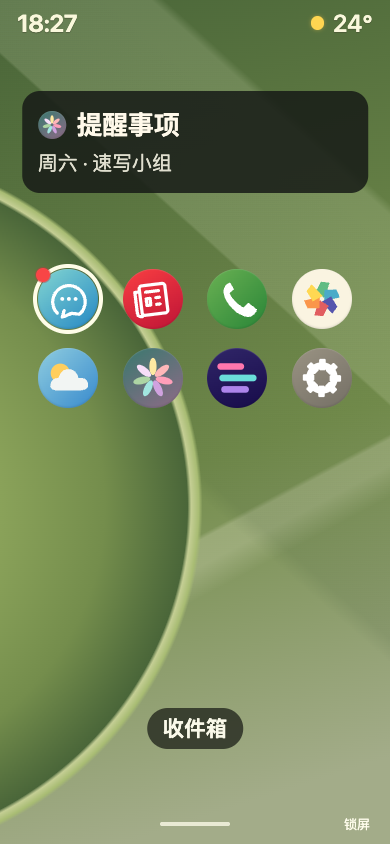

# Leonida Phone UI

一个可嵌入网页的全屏手机界面。圆形应用图标、通知卡片、渐变壁纸、锁屏和底部导航来自莱昂尼达手机的桌面设计。示例使用虚构的周末清单，所有交互都在浏览器本地运行。

<p></p>

[浏览器里直接试玩手机原型](https://micha957.github.io/leonida-phone-ui/)

## 本地试玩

下载或克隆仓库，在项目根目录运行下面的命令。示例使用浏览器原生 ES 模块，启动静态服务器即可。

```sh
git clone https://github.com/micha957/leonida-phone-ui.git
cd leonida-phone-ui
python3 -m http.server 8000 --bind 127.0.0.1
```

打开 [本地示例](http://127.0.0.1:8000)。点收件箱可以进入备忘录，返回键会回到收件箱。点色板可以换壁纸，点底部的「锁屏」后可点按或上滑解锁。键盘可用 Tab 进入图标区，用方向键选择，Enter 打开，Esc 返回。

## 接入自己的页面

把整个 `src/` 目录复制到项目里，保留三个文件的相对位置。`phone.js` 会在组件的 Shadow DOM 中加载同目录的 `phone.css`。父容器可以占满整个视口，也可以是一个有明确宽高的面板。下面的 HTML 保存到与 `src/` 同级的目录即可运行。

```html
<meta name="viewport" content="width=device-width,initial-scale=1,viewport-fit=cover">
<style>body { margin: 0 } #phone { height: 100dvh }</style>
<main id="phone"></main>
<script type="module">
  import { mountPhone } from './src/phone.js';

  const phone = mountPhone(document.querySelector('#phone'), {
    name: '我的手机',
    status: '24°',
    widget: { title: '提醒', text: '你有一条新消息', appId: 'inbox' },
    apps: [{
      id: 'inbox',
      label: '收件箱',
      icon: 'messages',
      badge: true,
      render({ container, phone }) {
        container.textContent = '欢迎来到你的第一个应用。';
        phone.setBadge('inbox', false);
      }
    }]
  });
</script>
```

## 配置桌面

| 配置 | 用法 |
| --- | --- |
| `apps` | 至少提供一个应用。数组顺序决定桌面顺序。每项需要唯一的字符串 `id`、显示名称 `label` 和 `render` 函数。 |
| `icon`、`image` | `icon` 选择内置图标。设置 `image` 可换成自己的图片。用 `new URL('./icon.png', import.meta.url).href` 可以让图片地址跟随配置文件。 |
| `badge` | 设为 `true` 显示通知红点，之后可用 `phone.setBadge(id, visible)` 更新。 |
| `name`、`status` | `name` 是供辅助技术读取的手机名称，`status` 是桌面右上角的短文本。 |
| `clock` | 缺省显示设备本地时间。可传入固定字符串或返回时间字符串的同步函数。界面每 30 秒刷新时钟。 |
| `widget` | 可选。设置 `title`、`text`、`appId` 和可选的 `icon`。点击卡片打开对应应用。 |
| `wallpaper` | 用 `{ base, light, mid, dark }` 指定壁纸的四个 CSS 颜色值。缺省颜色是鼠尾草绿。 |

内置图标有 `messages`、`contacts`、`camera`、`feed`、`gallery`、`news`、`weather`、`reminders`、`settings`。也可以从 `src/phone.js` 导入 `iconNames` 获取。

## 编写应用与导航

每次打开应用或返回它时，界面会创建新的内容容器，并调用 `render({ container, phone, signal })`。把表单草稿等持久状态放在渲染函数外。用 `signal` 在离开页面时取消自己的请求、定时器和订阅。比如下面这个应用从你自己提供的接口读取文本。

```js
const notice = {
  id: 'notice',
  label: '公告',
  icon: 'news',
  render({ container, signal }) {
    container.textContent = '正在读取…';
    fetch('/api/notice', { signal })
      .then(response => {
        if (!response.ok) throw new Error('读取失败');
        return response.text();
      })
      .then(text => { if (!signal.aborted) container.textContent = text; })
      .catch(() => { if (!signal.aborted) container.textContent = '公告暂时无法读取'; });
  }
};
```

将 `notice` 放进 `apps` 数组，再调用 `phone.open('notice')` 即可进入。该接口由接入方提供，本仓库自带的演示可离线运行。

| 方法 | 效果 |
| --- | --- |
| `phone.open(id)` | 打开已注册的应用，记住上一个页面。 |
| `phone.back()` | 回到上一级。在桌面使用会锁屏，在锁屏使用会解锁。 |
| `phone.home()`、`phone.lock()` | 回到桌面或进入锁屏。 |
| `phone.setBadge(id, true)` | 开启红点，传 `false` 关闭。 |
| `phone.setWallpaper(colors)` | 立即应用新配色。省略参数恢复默认色。 |
| `phone.destroy()` | 卸载当前实例，终止当前页面的 `signal` 并停止时钟。 |

应用页面与桌面共享 Shadow DOM。要给业务页面添加样式，可在渲染函数中向内容容器追加自己的样式表，并用应用专属的类名限定选择器。离开页面后，样式表会随容器一起释放。

完整可运行的应用注册表在 [demo/main.js](demo/main.js)。入口在 [src/phone.js](src/phone.js)，布局和壁纸在 [src/phone.css](src/phone.css)，内置图标在 [src/icons.js](src/icons.js)。接入其他项目时可以保留桌面，独立替换其中任意一个示例应用。

## 许可证

本项目的界面代码和演示以 [MIT 许可证](LICENSE) 开源。
